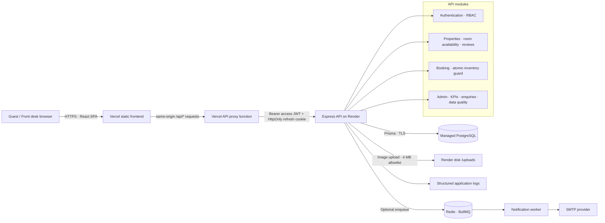

# Serein Stays — architecture

## Request path

1. React submits validated JSON to `/api`; Vite proxies the same paths to Express in development. In production, a same-origin Vercel function forwards `/api/*` to Render so the refresh cookie remains first-party.
2. Express applies request IDs, security headers, CORS, rate limits and consistent error serialization.
3. Zod validates untrusted request data again on the server. The API service layer checks ownership, roles, dates and inventory.
4. `PrismaStore` persists to PostgreSQL when `DATABASE_URL` is configured. Without a database URL, a seeded in-memory adapter makes the complete demo runnable in a preview environment.
5. Booking writes are serialized per room type with a PostgreSQL transaction advisory lock. The lock is intentionally conservative: it prevents two API instances from overselling, at the cost of serializing booking attempts for the same room type.
6. Optional notifications go through BullMQ/Redis. The API remains usable if email is not configured; jobs are logged as skipped rather than failing a booking or enquiry.

## Data model

`User` → `Booking` and `Review`; `Property` → `RoomType`, `Booking`, `Review`; `Inquiry`, `RefreshToken` and `ImportIssue` are independent operational records. A room type retains its imported `sourceLabel`, native `basePrice`/`currency`, and normalized `priceInr`. Each booking stores a server-calculated INR total. Rejected legacy stays are recorded in `ImportIssue`, not included in availability or KPI math.
